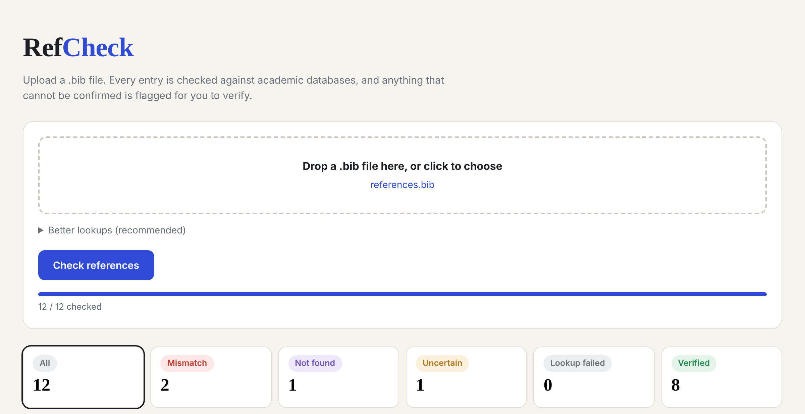

# RefCheck

Check every entry in a BibTeX file against academic databases. Anything that cannot be confirmed is flagged for manual review.

## Description

| Result | Meaning |
|:---|:---|
| Verified | Matches a database record. |
| Mismatch | The paper exists, but some details differ. The database record is shown. |
| Uncertain | A close but not exact title match, or the entry lacks a field. |
| Not&nbsp;found | No matching record. Books, web pages and some workshop papers are often not indexed. |
| Lookup&nbsp;failed | A database did not respond for this entry. Retry. |
